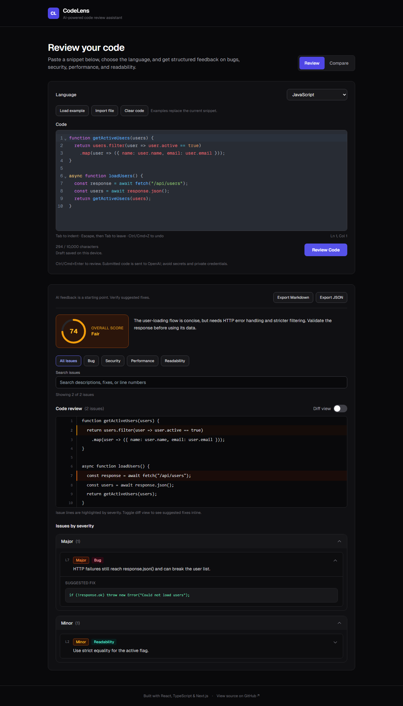

# CodeLens

[](https://github.com/pritishhhh/codelens/actions/workflows/ci.yml)

A React and TypeScript workspace for AI-assisted code review and solution comparison. Paste or import a snippet, inspect actionable feedback, and export the analysis with its original source.



*Interface preview with illustrative review feedback.*

## Features

- **Code editor:** CodeMirror 6 with syntax highlighting, line numbers, bracket matching, folding, search, indentation, and undo/redo.
- **Six languages:** JavaScript/JSX, TypeScript/TSX, Python, Java, C++, and Go.
- **Structured reviews:** Quality score, severity groups, category filters, issue search, and suggested fixes alongside annotated source.
- **Solution comparison:** Side-by-side editors, scores, strengths, weaknesses, a winner, and an explanation.
- **Persistent drafts:** Separate review and comparison drafts survive reloads and mode changes in this browser.
- **File import:** Read source files locally, infer the language, normalize line endings, and validate size before replacing code.
- **Examples:** Review snippets and comparison pairs for every supported language, plus a swap action.
- **Exports:** Download complete Markdown or JSON reports, including submitted source and unfiltered feedback.
- **Request controls:** Cancel analysis, retry failures, and ignore stale responses after switching modes.
- **Accessible navigation:** Named editors, keyboard mode tabs, visible focus states, responsive layouts, and reduced-motion support.

## Run locally

Use **Node.js 22.13 or newer** and npm.

```bash
git clone https://github.com/pritishhhh/codelens.git
cd codelens
npm ci
cp .env.example .env.local
npm run dev
```

On Windows, use `Copy-Item .env.example .env.local` instead of `cp`.

Set `OPENAI_API_KEY` in `.env.local`. The key stays on the server; never prefix it with `NEXT_PUBLIC_` or commit it. `OPENAI_MODEL` optionally overrides the default `gpt-4o`; choose a model compatible with Chat Completions and JSON object output.

Open [localhost:3000](http://localhost:3000). Editing, examples, draft saving, and file import work without an API key; real analysis requires a configured key and provider quota.

## Keyboard shortcuts

| Action | Shortcut |
| --- | --- |
| Review or compare | Ctrl/Cmd + Enter |
| Undo / redo | Ctrl/Cmd + Z / Shift + Ctrl/Cmd + Z |
| Find in editor | Ctrl/Cmd + F |
| Indent / outdent | Tab / Shift + Tab |
| Leave editor | Escape, then Tab |
| Change mode while a tab is focused | Left / Right arrow, Home / End |

Snippets are limited to **10,000 characters each**. Imported files are read in the browser and are sent to the server only when submitted. Examples replace the current snippet or pair.

## Architecture

```text
src/app/page.tsx          Mode selection, request lifecycle, and submitted-result snapshots
src/app/api/             Server-only review and comparison routes
src/components/          Editors, forms, feedback, annotations, and report downloads
src/hooks/               SSR-safe persistent draft hook
src/lib/                 Prompts, runtime validation, examples, drafts, and report formatting
src/types/               Shared TypeScript request and result contracts
tests/unit/              Validators, reports, and API behavior with a mocked provider
tests/e2e/               Desktop and mobile browser workflows
```

**React state management:** Controlled editor documents and a reusable persistence hook keep each draft independent. Storage hydrates after mount to avoid server/client markup mismatches and never overwrites a saved draft with initial empty state.

**Async correctness:** An `AbortController` and request identity guard prevent cancelled or superseded requests from changing the active view. Retry uses the last submitted snapshot. The provider has a 60-second timeout; the browser has a 120-second fallback.

**Runtime contracts:** TypeScript describes the data, while runtime validators check actual AI responses. Invalid input returns 400; malformed AI output returns 502. Review issues must reference a line that exists in the unchanged source.

**Editor correctness:** CodeMirror owns text, highlighting, selection, and cursor measurement in one document. The former transparent textarea overlay used inconsistent padding and font metrics. Font loading now triggers remeasurement instead of relying on a cursor offset.

**Exports:** Markdown and JSON are generated locally. Code fences grow when the source contains backticks, preserving the snippet inside the exported report.

## Quality checks

```bash
npm run lint
npm run typecheck
npm test
npm run build
npx playwright install chromium
npm run test:e2e
```

GitHub Actions runs these checks on pushes and pull requests to `main`, including browser tests against the production build. Tests use mocked responses and do not require an API key or spend provider credits. Browser projects cover desktop Chromium and a mobile viewport.

## Deployment

Use a Node-compatible Next.js host. Set `OPENAI_API_KEY` and optionally `OPENAI_MODEL` in its server environment, then run `npm run build` and `npm start`. These API routes cannot run in a static-only export.

## Limitations and tradeoffs

- AI reviews can miss problems or suggest incorrect fixes. CodeLens does not compile or execute submitted snippets.
- Drafts are plaintext in this browser's local storage; there is no account, cloud synchronization, or saved report history. Clear a draft before leaving a shared device.
- Both comparison solutions use the selected language.
- The API currently has no application authentication or distributed rate limiter. Add access controls and provider spending limits before exposing a paid key through an unrestricted public deployment.
- Cancelling a request stops local waiting and attempts to abort the provider request. It cannot guarantee cancellation of provider work or charges already incurred.
- Next.js and its PostCSS dependency were patched. Development tooling still has upstream audit findings; see [review notes](docs/REVIEW_NOTES.md).

## Engineering walkthrough

This project demonstrates component composition, custom hooks, controlled state, TypeScript unions and type guards, API integration, request cancellation, local persistence, responsive styling, runtime validation, browser testing, and continuous integration.

For an interview demo: load the JavaScript example, review it, filter the issues, export a report, compare the paired examples, then reload to demonstrate saved drafts.
